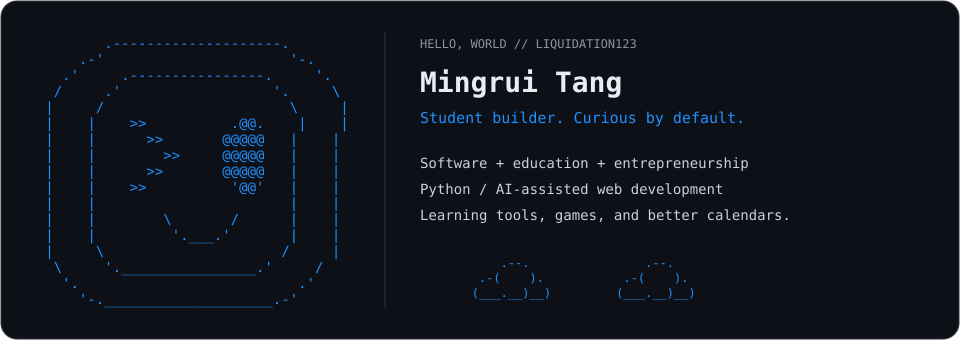

  <a href="#projects">Projects</a> &nbsp; / &nbsp;
  <a href="#about--toolbox">About &amp; toolbox</a> &nbsp; / &nbsp;
  <a href="https://math-knockout-2.onrender.com/">Play Out-Mathed</a> &nbsp; / &nbsp;
  <a href="https://www.linkedin.com/in/-mingrui-tang">LinkedIn</a>

## Projects

<table>
<tr>
<td width="50%" valign="top">
<h3>01 / Out-Mathed</h3>

<b>Draw a fighter. Plot an equation.</b>

A collaborative browser game with curve-driven combat, drawing-based mass and inertia, AI opponents, and online multiplayer rooms.

<code>JavaScript</code> <code>Three.js</code> <code>Node.js</code> <code>WebSockets</code>

<a href="https://github.com/liquidation123/Math-Knockout">Code →</a> &nbsp; <a href="https://math-knockout-2.onrender.com/">Play →</a>

</td>
<td width="50%" valign="top">
<h3>02 / DECA Study Companion</h3>

<b>Make each reviewed mistake useful.</b>

A Chrome extension for practice-question review, vocabulary learning, and mistake patterns, with AI explanations and verified saves to selected Google Docs and Sheets.

<code>JavaScript</code> <code>Chrome MV3</code> <code>OpenAI API</code> <code>Google APIs</code>

<a href="https://github.com/liquidation123/DECA_MC_assistant">Code →</a>

</td>
</tr>
<tr>
<td colspan="2" valign="top">
<h3>03 / AkaeWeo</h3>

<b>Give student work a place on the calendar.</b>

An AI-powered planner connecting tasks, calendars, project timelines, and natural-language assistance. Scheduling accounts for priorities, deadlines, and availability, with a Firebase backend and Google Calendar/Tasks integration.

<code>React</code> <code>TypeScript</code> <code>Firebase</code> <code>Gemini</code> &nbsp; · &nbsp; <i>In development / private source</i>

</td>
</tr>
</table>

<pre>       .--.                                .--.
    .-(    ).           .--.            .-(    ).
   (___.__)__)       .-(    ).         (___.__)__)
                    (___.__)__)</pre>

## About & toolbox

<table>
<tr>
<td width="50%" valign="top">
<h3>The person</h3>

I'm interested in where <b>software, education, and entrepreneurship</b> meet.

I enjoy shaping ideas, building working prototypes, and bringing teammates' contributions together.

</td>
<td width="50%" valign="top">
<h3>The approach</h3>

<b>Strongest language:</b> Python

<b>Project experience:</b> JavaScript, TypeScript, React, Firebase, and API integrations.

<b>Workflow:</b> AI-assisted development, Git collaboration, and iterative prototyping.

</td>
</tr>
</table>

<pre>       .--.                                .--.
    .-(    ).           .--.            .-(    ).
   (___.__)__)       .-(    ).         (___.__)__)
                    (___.__)__)</pre>
